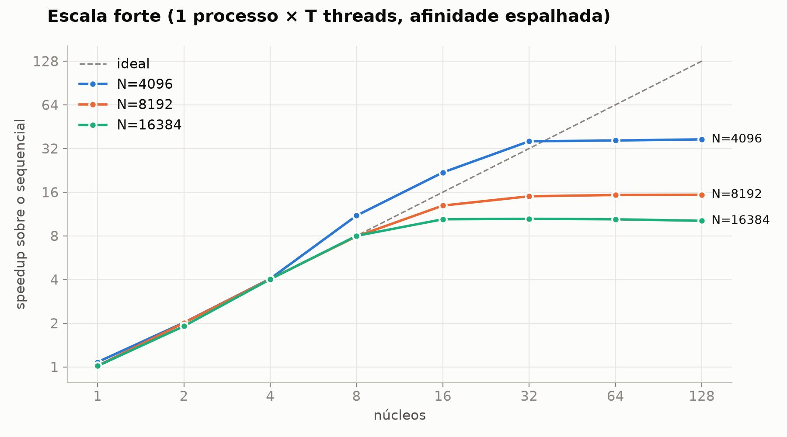
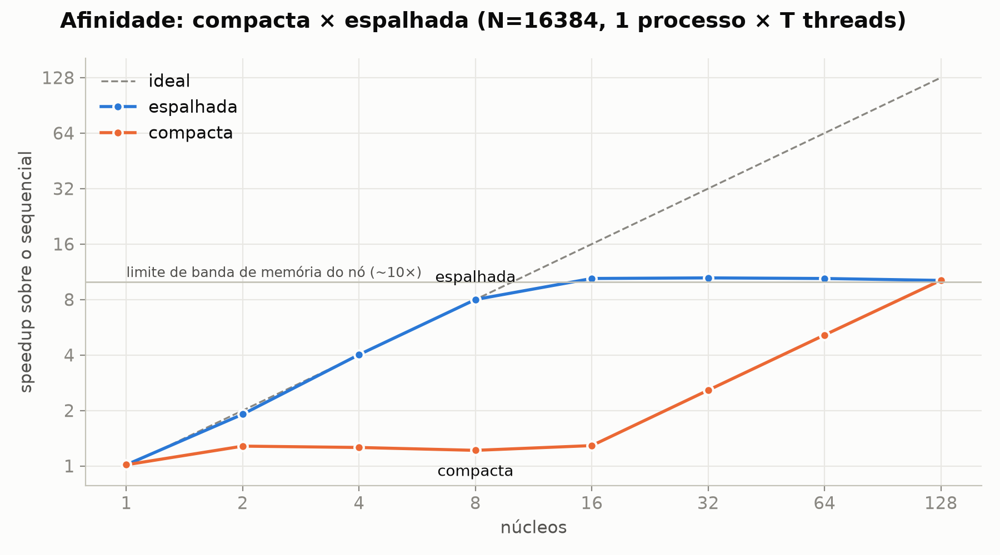
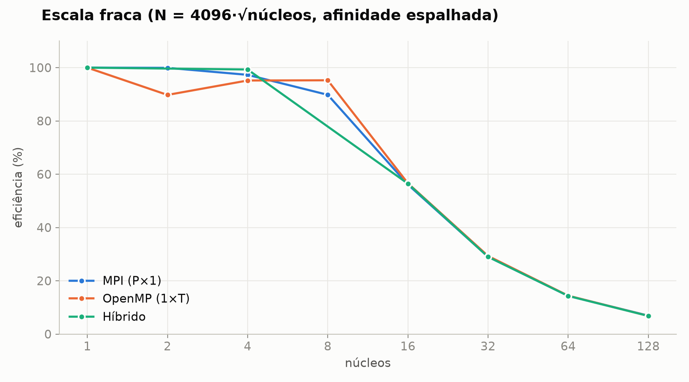
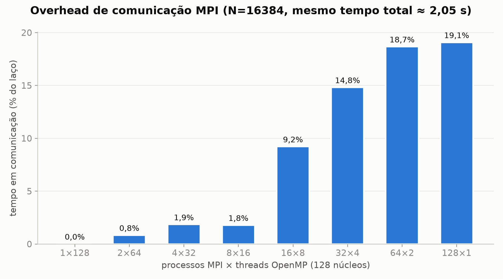

# Projeto HPC — Simulação de Difusão de Calor em uma Placa 2D

## 1. Sobre o projeto

Este projeto tem como objetivo desenvolver e avaliar diferentes estratégias de paralelização para a simulação da difusão de calor em uma placa bidimensional, utilizando o método de diferenças finitas (*Finite Difference Method*) com stencil de 5 pontos.

A simulação representa a evolução temporal da temperatura em uma matriz 2D, na qual a temperatura de cada célula é atualizada a partir da média dos seus quatro vizinhos (acima, abaixo, esquerda e direita).

O projeto busca comparar o desempenho de diferentes abordagens computacionais, desde a implementação sequencial até técnicas de paralelização em CPU e GPU.

## 2. Objetivos

- Implementar uma versão sequencial para servir como baseline de desempenho.
- Desenvolver uma implementação híbrida utilizando MPI + OpenMP.
- Desenvolver uma implementação utilizando OpenMP Target para execução em GPU.
- Desenvolver uma implementação utilizando CUDA.
- Avaliar o desempenho das diferentes abordagens.
- Analisar speedup, eficiência e escalabilidade das implementações.

## 3. Fundamentação do problema

A placa é representada por uma matriz bidimensional de valores do tipo `double`, na qual cada elemento representa a temperatura de um ponto.

A atualização ocorre iterativamente, considerando a média dos quatro vizinhos de cada célula:

```text
           cima
             |
esquerda -- célula -- direita
             |
           baixo
```

São utilizadas condições de contorno fixas, como uma das bordas mantida a 100 °C e as demais a 0 °C.

O problema apresenta características adequadas ao modelo BSP (*Bulk Synchronous Parallel*), permitindo a divisão do domínio computacional em regiões independentes, com sincronização entre as etapas de processamento.

## 4. Tecnologias utilizadas

- **Linguagem:** C/C++
- **Compilação:** GCC e Make
- **Paralelismo distribuído:** MPI
- **Paralelismo em CPU:** OpenMP
- **Computação em GPU:** OpenMP Target e CUDA
- **Ambiente de execução:** NPAD/UFRN
- **Controle de versão:** Git e GitHub

## 5. Organização do projeto

```text
projeto-hpc/
│
├── etapa-sequencial/
│   ├── Makefile
│   ├── heat_seq.c
│   ├── heat_common.h
│   ├── compare_grids.c
│   ├── run_seq.slurm
│   └── resultados/
│       ├── resultados.csv
│       └── assinaturas e logs
│
├── etapa-hibrida/
│   ├── Makefile
│   ├── heat_hib.c
│   ├── run_hib.slurm
│   ├── analise.py
│   ├── graficos.py
│   ├── graficos/
│   └── resultados/
│       ├── resultados.csv
│       ├── detalhes.csv
│       └── tabelas.md
│
├── etapa-openmp-target/       # Planejada
│   └── OpenMP Target
│
├── etapa-cuda/                # Planejada
│   └── CUDA
│
├── README.md
└── .gitignore
```

## 6. Implementações

### 6.1. Versão sequencial — Baseline

Implementação inicial utilizada como referência para as comparações de desempenho.

**Status:** Concluída.

Características:
- Processamento sequencial da matriz.
- Atualização iterativa utilizando stencil de 5 pontos.
- Condições de contorno fixas.
- Validação dos resultados.
- Coleta de tempos de execução.

### 6.2. Versão híbrida — MPI + OpenMP

Combina paralelismo distribuído entre processos MPI e paralelismo por threads OpenMP.

**Status:** Concluída (experimentos executados no NPAD).

Características:
- Decomposição 1D por blocos de linhas; cada processo gera apenas as suas linhas.
- Troca de halo (1 linha acima e 1 abaixo) com `MPI_Isend`/`MPI_Irecv`, sobreposta ao cálculo das linhas internas (`-b` usa troca bloqueante).
- OpenMP dentro de cada processo (`MPI_THREAD_FUNNELED`), com inicialização paralela (*first touch*).
- Grade final e assinatura idênticas bit a bit às do sequencial, para qualquer combinação de processos e threads.
- Reutiliza `etapa-sequencial/heat_common.h`.

### 6.3. Versão GPU — OpenMP Target

Implementação planejada para explorar o processamento em GPU por meio das diretivas de offloading do OpenMP.

**Status:** Planejada.

### 6.4. Versão GPU — CUDA

Implementação planejada utilizando CUDA para execução dos cálculos diretamente na GPU, explorando paralelismo em larga escala.

**Status:** Planejada.

## 7. Ambiente de execução

Os experimentos serão realizados no ambiente de computação de alto desempenho NPAD/UFRN.

A submissão dos experimentos será realizada por meio do escalonador SLURM.

Acesso ao ambiente:

```bash
ssh -p 4422 usuario@sc2.npad.ufrn.br
```

## 8. Compilação e execução

### Versão sequencial

Acessar o diretório:

```bash
cd ~/projeto-hpc/etapa-sequencial
```

Compilar:

```bash
make
```

Executar os testes de validação:

```bash
make test
```

Submeter o experimento ao SLURM:

```bash
sbatch run_seq.slurm
```

Acompanhar a execução:

```bash
squeue -u $USER
```

Consultar o log:

```bash
tail -f <ID>.out
```

### Versão híbrida (MPI + OpenMP)

```bash
cd ~/projeto-hpc/etapa-hibrida
module load libraries/openmpi/4.1.8-gnu8
make
make test                                  # compara com o sequencial, bit a bit
sbatch run_hib.slurm                       # escala forte, afinidade compacta
AFFINITY=spread sbatch run_hib.slurm      # processos/threads espalhados pelos domínios NUMA
PAIRS="4096:1x1 5793:2x1 8192:4x1" CSV=resultados/fraca.csv sbatch run_hib.slurm   # escala fraca
python3 analise.py > resultados/tabelas.md
python3 graficos.py                        # requer matplotlib
```

No NPAD, o `srun` precisa de `--mpi=pmix` (já incluído no script).

## 9. Experimentos e avaliação de desempenho

Os experimentos buscam avaliar o comportamento das implementações considerando diferentes dimensões de matrizes e configurações de processamento.

As métricas analisadas serão:

- **Tempo de execução:** tempo necessário para concluir a simulação.
- **Speedup:** relação entre o tempo sequencial e o tempo paralelo.
- **Eficiência:** aproveitamento dos recursos computacionais utilizados.
- **Escalabilidade:** comportamento do desempenho conforme o aumento dos recursos ou do volume de dados.

Também serão realizadas múltiplas repetições para cada configuração, permitindo analisar a variação dos tempos de execução.

## 10. Resultados — Baseline sequencial

A primeira etapa experimental foi executada no NPAD/UFRN.

Foram utilizadas cinco dimensões de matriz, com cinco repetições para cada dimensão.

| Dimensão (N) | Mínimo (s) | Média (s) | Máximo (s) |
|---:|---:|---:|---:|
| 4096 | 1,212112 | 1,221104 | 1,226527 |
| 5793 | 2,315369 | 2,320445 | 2,325145 |
| 8192 | 4,697499 | 4,719858 | 4,742258 |
| 11585 | 9,599890 | 9,630896 | 9,658060 |
| 16384 | 20,543153 | 20,637785 | 20,716199 |

Total de medições: 25.

Os dados completos estão disponíveis em:

```text
etapa-sequencial/resultados/resultados.csv
```

O baseline sequencial será utilizado como referência para as análises comparativas das implementações paralelas.

## 11. Resultados — Versão híbrida (MPI + OpenMP)

Executada no NPAD, partição `amd-512` (2× AMD EPYC 7713, 128 núcleos, 8 domínios NUMA de 16 núcleos), OpenMPI 4.1.8 com gcc 8.5 (mesmo compilador do baseline), 100 iterações, 5 repetições por configuração (mediana). Todas as execuções reproduziram a assinatura do sequencial.

### Escala forte

| N | Sequencial (s) | 1×8 (s) | Speedup | 1×128 (s) | Speedup | 8×16 (s) | Speedup |
|---:|---:|---:|---:|---:|---:|---:|---:|
| 4096 | 1,224 | 0,111 | 11,0× | 0,033 | 37,0× | 0,041 | 30,2× |
| 5793 | 2,320 | 0,331 | 7,0× | 0,053 | 43,9× | 0,069 | 33,5× |
| 8192 | 4,721 | 0,595 | 7,9× | 0,307 | 15,4× | 0,313 | 15,1× |
| 11585 | 9,632 | 1,203 | 8,0× | 0,880 | 10,9× | 0,883 | 10,9× |
| 16384 | 20,650 | 2,581 | 8,0× | 2,033 | 10,2× | 2,051 | 10,1× |

(P×T = processos MPI × threads OpenMP, afinidade espalhada.)



- O stencil é **limitado por banda de memória**: cada ponto faz 4 somas e 1 multiplicação, mas lê e escreve 5 `double`.
- O speedup é quase linear até 8 núcleos (um por domínio NUMA) e satura em **~10×** para N ≥ 11585: é o limite de banda de memória do nó.
- N = 4096 e 5793 passam desse limite (até 44×) porque as duas grades cabem nos 512 MB de L3 somados do nó.

### Afinidade



- Com afinidade compacta, de 1 a 16 núcleos ficam no **mesmo domínio NUMA**, e um núcleo sozinho já quase satura a banda dele: o ganho é de só ~1,2×.
- Espalhando processos e threads pelos domínios, 8 núcleos rendem 8×. Neste problema, **onde** os núcleos estão importa mais do que **quantos** são.

### Escala fraca



- N cresce com √núcleos, mantendo o trabalho por núcleo constante (até N = 46341 em 128 núcleos).
- A eficiência fica em 90–100% até 8 núcleos e cai pela metade a cada dobra a partir daí: é o mesmo limite de banda.

### Comunicação MPI e balanceamento de carga



- Em 128 núcleos, todas as divisões P×T dão o mesmo tempo (~2,05 s para N = 16384), mas a fração gasta em comunicação cresce com o número de processos: **1,8% em 8×16 contra 19,1% em 128×1**.
- A divisão em blocos dá no máximo 1 linha de diferença entre processos. O desbalanceamento medido (cálculo máximo ÷ médio) fica em ~1,00 com poucos processos e sobe para 1,2 em 128×1, por disputa de memória, não por divisão desigual.
- A troca de halo sobreposta ao cálculo e a bloqueante ficaram dentro de ±2%: as mensagens são pequenas (1 linha) e, dentro de um nó, não há tempo de comunicação para esconder.

Dados completos: `etapa-hibrida/resultados/` (`resultados.csv`, `detalhes.csv` e `tabelas.md`).

## 12. Próximas etapas

1. Consolidar e documentar o baseline sequencial.
2. Dividir o grupo em duplas para desenvolvimento das implementações paralelas.
3. Implementar a versão híbrida MPI + OpenMP.
4. Implementar a versão OpenMP Target.
5. Implementar a versão CUDA.
6. Executar os experimentos variando dimensões, processos e threads.
7. Coletar e organizar os resultados.
8. Gerar gráficos comparativos de tempo, speedup, eficiência e escalabilidade.
9. Elaborar a análise final dos resultados.

## 13. Equipe

**Integrantes:**  
- GILDO CORDEIRO DUARTE 
- DOUGLAS FELIPE DE LIMA SILVA
- LAURA DE FATIMA MARCELINO FONSECA
- SÉRGIO LIMA SILVA DO CARMO 

**Projeto desenvolvido como parte das atividades acadêmicas da disciplina de Computação de Alto Desempenho.**
